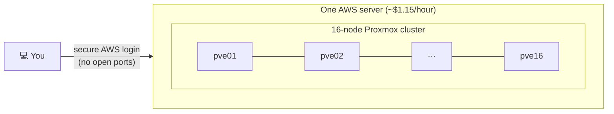
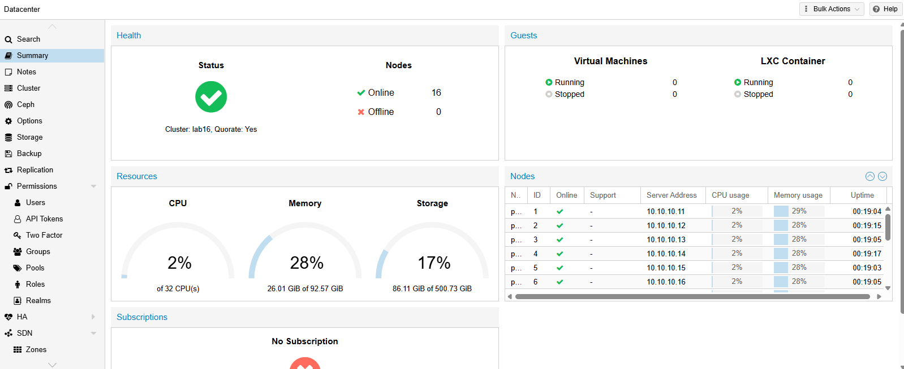
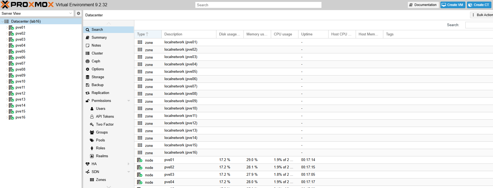
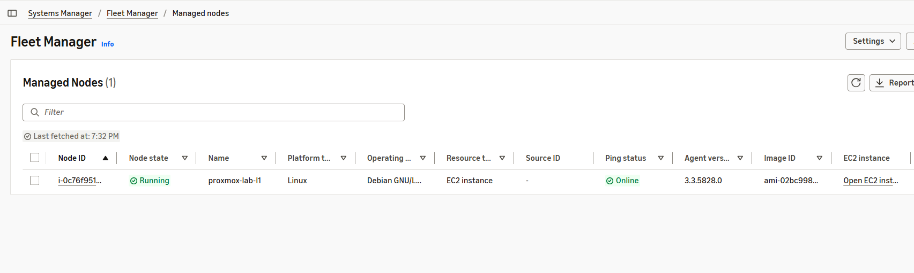
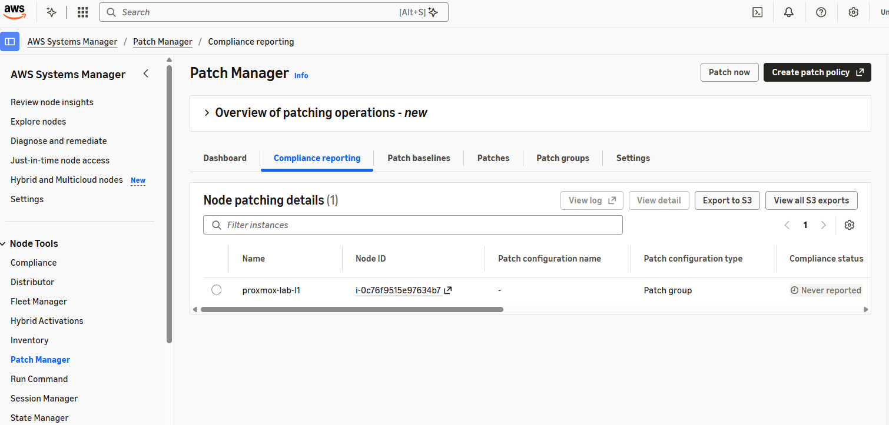

# Proxmox Lab on AWS

**A 16-server Proxmox cluster that builds itself from code, runs on one rented
AWS machine, and deletes itself when you're done.**

Proxmox is software companies use to run many virtual machines across a group
of servers. Practicing with it normally means buying a rack of hardware. This
project rents one large AWS server by the hour and runs 16 virtual Proxmox
servers inside it, joined into a cluster.



## How it works

1. **Packer** builds a disk image with Proxmox already installed (done once).
2. **Terraform** starts the AWS server from that image (one command).
3. **Ansible** runs on the server and builds the 16-node cluster (~30–40 min, no input needed).
4. You open the Proxmox web UI in your browser and use the cluster.
5. One command deletes everything. If you forget, the server deletes itself after 4 hours.

## Why it's built this way

- **Cost-capped:** you pay only while it runs. One session costs at most about $4.60 (4-hour cap).
- **Safe:** nothing on the internet can reach it. Access is through AWS's own login (SSM).
- **Repeatable:** everything is code, so the whole lab can be rebuilt from this repo at any time.

## Status

| Step | Status |
|---|---|
| Disk image builds and Proxmox boots on AWS | ✅ Verified (Nov 2026) |
| Full 16-node cluster comes up (16 nodes + QDevice, quorate) | ✅ Verified (Nov 2026) |
| Kubernetes on top (Phase 2: 3 + 3 Talos VMs) | 🧪 Written, **not yet tested** end to end |

## Screenshots

From the first full run (Nov 2026).

**The cluster:** `lab16` quorate, 16 of 16 nodes online.



**All 16 nodes** in the Proxmox VE 9.2 web UI, reached through the SSM tunnel (`.\scripts\lab.ps1 gui`).



**The AWS side:** the server is managed through SSM only (no SSH, no open ports), shown here in Fleet Manager…



…and registered with Patch Manager (no patch policy configured yet).



## Quick start (Windows)

**You need:** Terraform, Packer, AWS CLI v2, the
[Session Manager plugin](https://docs.aws.amazon.com/systems-manager/latest/userguide/session-manager-working-with-install-plugin.html),
and an AWS account.

```powershell
# 1. Build the image (once, ~25 min, a few cents)
cd packer; packer init .; packer build .; cd ..

# 2. Start the lab
copy terraform\terraform.tfvars.example terraform\terraform.tfvars
#    then set aws_account_id in it: Terraform refuses to touch any other account
terraform -chdir=terraform init
terraform -chdir=terraform apply

# 3. Use it
.\scripts\lab.ps1 status     # wait for "BOOTSTRAP COMPLETE"
.\scripts\lab.ps1 password   # get the login password
.\scripts\lab.ps1 gui        # then open https://localhost:8006 (user: root)

# 4. Delete everything
terraform -chdir=terraform destroy
```

## Cost

| | |
|---|---|
| While running | ~$1.15/hour (on-demand r8i.4xlarge + disks) |
| One session (max 4 hours) | ~$4.60 at most |
| When deleted | ~$0.30/month (stored disk image) |

## What's in the repo

| Folder | What it does |
|---|---|
| `packer/` | Builds the Proxmox disk image |
| `terraform/` | Creates the AWS network, permissions and server |
| `ansible/` | Builds the 16-node cluster on the server |
| `kubernetes/` | Phase 2 (untested): Talos Kubernetes VMs, run on the server after the cluster |
| `scripts/` | `lab.ps1`: check progress, open the web UI, get the password |
| `docs/` | Design details, trade-offs and roadmap |

## Want the technical details?

[docs/architecture.md](docs/architecture.md) covers the network layout (VLANs),
cluster voting (quorum and QDevice), storage (ZFS, optional Ceph), the security
design, and known limitations.

**Coming next:** verify Kubernetes (Phase 2), then GitOps with Argo CD, backups, and CI checks.
