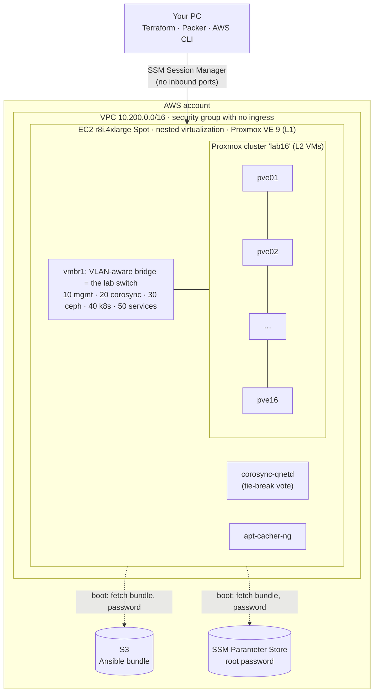

# Proxmox Lab on AWS: 16-node cluster, rebuilt from Git on demand

A 16-node Proxmox VE 9 cluster with VLAN-separated networks, a QDevice
tie-breaker and optional hyper-converged Ceph. It runs **nested on a single
EC2 instance** and is built entirely by Packer, Terraform and Ansible. One
`terraform apply` brings it up in roughly 30–40 minutes. It shuts itself down
after a fixed time limit (TTL), so between sessions it costs almost nothing.



## What this demonstrates

| Area | Implementation |
|---|---|
| Immutable images | Packer bakes Debian 13 + Proxmox VE 9 into an AMI. The same install script is reused for the nested nodes. |
| Infrastructure as code | Terraform: VPC, IAM (least privilege), launch template with `nested_virtualization`, Spot, budget guardrail |
| Configuration management | Ansible runs **on the instance at boot**, so there is no Windows/WSL control node and no SSH from outside |
| Cluster design | 16 nodes, a dedicated corosync VLAN (link0) with mgmt as fallback (link1), and a QDevice so an 8/8 split keeps quorum |
| Storage | ZFS on EBS (ARC capped) for node disks. Optional Ceph: 5 MON, 3 MGR, 16 OSD, 3/2 replication |
| Security | No inbound rules, SSM-only access, IMDSv2 with hop limit 1 plus a forward-drop rule so nested guests can't steal the instance role, encrypted EBS, password in SSM |
| Cost / FinOps | Spot instances, a TTL self-terminate that can't be skipped, everything `force_destroy`-able, optional AWS Budget |

## Cost

| Item | While running | While destroyed |
|---|---|---|
| r8i.4xlarge | roughly $1.1/h on-demand, typically far less on Spot. **Check current prices for your region.** | $0 |
| EBS 280 GB gp3 | ≈ $0.03/h | $0 (deleted on termination) |
| Public IPv4 | $0.005/h | $0 |
| AMI snapshot (~6 GB) | – | ≈ $0.30/month |

A 4-hour session costs a few dollars. Monthly cost scales with hours used, and
the TTL guarantees an upper bound per launch.

## Prerequisites (Windows)

- Terraform ≥ 1.6, Packer ≥ 1.10, AWS CLI v2, and the [Session Manager plugin](https://docs.aws.amazon.com/systems-manager/latest/userguide/session-manager-working-with-install-plugin.html)
- AWS credentials for an account with a default VPC (used only by the Packer build)

## Usage

```powershell
# 1. Bake the AMI (once; ~15 min on a t3.medium, a few cents)
cd packer;  packer init .;  packer build .;  cd ..

# 2. Bring the lab up
copy terraform\terraform.tfvars.example terraform\terraform.tfvars
terraform -chdir=terraform init
terraform -chdir=terraform apply

# 3. Watch the build, then open the UI
.\scripts\lab.ps1 status      # wait for "BOOTSTRAP COMPLETE"
.\scripts\lab.ps1 password
.\scripts\lab.ps1 gui         # https://localhost:8006 -> root / Linux PAM

# 4. Done for the day (or let the TTL do it)
terraform -chdir=terraform destroy
```

If the TTL terminated the instance, the next `apply` recreates it. Run
`destroy` anyway to remove the VPC, bucket and parameter.

## Layout

```
packer/      AMI: Debian 13 -> Proxmox VE 9 + bootstrap tools
terraform/   AWS: VPC, IAM, S3 bundle, SSM secret, Spot launch template, budget
ansible/     Runs on the L1 host: lab network, ZFS, nested nodes, cluster, QDevice, Ceph
  files/pve-install.sh   one Proxmox installer shared by Packer and Ansible
scripts/     lab.ps1: status / gui / shell / password via SSM
docs/        architecture.md: design, decisions, limits, roadmap
```

See [docs/architecture.md](docs/architecture.md) for the design decisions and known limitations.
